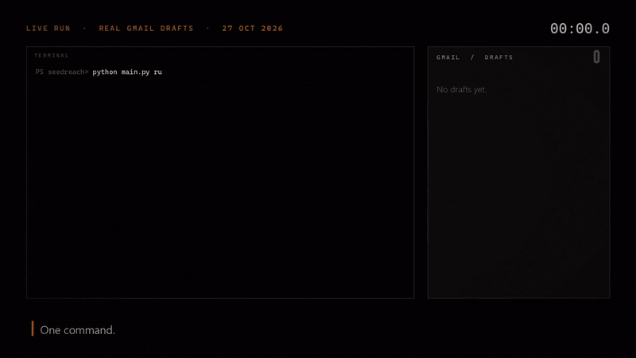

# seedreach

[](https://github.com/Poushali-02/seedreach/actions/workflows/tests.yml)
[](LICENSE)

Finds early-stage startups that are hiring, reads what they build, finds a founder's email, and saves a
personalised cold email to your **Gmail Drafts**. You review it and press Send. It never sends anything itself.



[Watch the full 80-second demo with sound (MP4)](https://github.com/Poushali-02/seedreach/releases/download/v0.1.0/seedreach-demo.mp4)

> **Status:** early (v0.3). Built for my own internship search and maintained in my spare time.
> Issues and pull requests are welcome; see [CONTRIBUTING.md](CONTRIBUTING.md).

A CLI that finds early-stage startups, reads their website with an LLM, finds a founder's email, and
saves a personalized plain-text cold email to your **Gmail Drafts** for you to review and send yourself.

It is built for people looking for internships or early jobs at small startups. You describe yourself once
in `profile.json`, and every draft picks the project of yours that best matches the company's domain.

**It never sends email.** The Gmail client only calls `drafts().create`, and a test fails if a `send`
call is ever added. Every message waits in your Drafts until you read it and press Send.

```
sources (HN / Product Hunt / manual) -> scraper -> LLM extractor -> email finder
        -> email generator -> Gmail draft -> SQLite (dedupe + status)
```

## Responsible use

This tool writes email to real people, so please use it with care:
- Read every draft before sending, and fix anything the model got wrong (founder names especially).
- Keep volume low and relevant. Send to people you have a real reason to contact, not to everyone you can find.
- Guessed addresses (`{first}@domain`) are unverified. Check them.
- You are responsible for following email and privacy laws where you and your recipients live
  (for example CAN-SPAM, GDPR). Honour any request to stop contacting someone.

## Requirements

- Python 3.10 or newer
- A Gmail account
- A Google Cloud project (free) for Gmail access
- An LLM API key: Gemini (free tier available) or Anthropic

## Setup

### 1. Install

```bash
git clone <your-fork-url>
cd seedreach
python -m venv .venv
# Windows PowerShell:  .venv\Scripts\Activate.ps1
# macOS / Linux:       source .venv/bin/activate
pip install -r requirements.txt
```

On Windows, keep the project in a short path such as `C:\dev\seedreach`. Very long folder
paths make `pip` fail inside the venv.

### 2. Describe yourself in `profile.json`

```bash
cp profile.example.json profile.json     # Windows: copy profile.example.json profile.json
```

Edit `profile.json`. It is git-ignored, so your details stay on your machine.

| Field | Required | What it is |
|---|---|---|
| `name` | yes | Your full name. The first word is used in the intro. |
| `intro` | yes | Completes "I'm Alex, ..." e.g. `a Computer Science student (graduating 2028) based in Lisbon`. |
| `role_pitch` | yes | Completes "I'd love to join Company as ..." e.g. `a remote Backend intern.` (long emails) |
| `experience` | yes | One or two sentences about your most relevant experience. (long emails) |
| `stack` | yes | Your core technologies, as a phrase. |
| `projects` | yes | Paragraphs per company domain: `DevTools`, `Fintech`, `AI Agents`, `B2B SaaS`, and a required `Other` fallback. Short emails use the **first sentence of the first paragraph**, so make that sentence your strongest proof (e.g. `I built Angizo (1st prize, Hexafalls 2026), ...`). |
| `portfolio`, `github`, `linkedin`, `resume`, `phone` | no | Shown at the bottom. Blank ones are left out. |
| `subject` | no | Subject line; `{company}` is replaced with the company name. |
| `closing` | no | The closing line before your links. (long emails) |
| `email_style` | no | `short` (default, about 100–130 words: opener, who you are, one project, one ask, two links) or `long` (every section above). |
| `ask` | no | The short email's last line; `{company}` is replaced. Default: *Would you be open to a remote intern at {company}? I'd be glad to start with a short trial task.* |

Plain text only: emails must not contain `*`, `#` or backticks, and the generator refuses to build a draft
that does.

### 3. Add an LLM API key

```bash
cp .env.example .env                     # Windows: copy .env.example .env
```

**Option A: Gemini (free tier).** Create a key at https://aistudio.google.com/apikey and set
`GEMINI_API_KEY=` in `.env`. This is the default (`LLM_PROVIDER=gemini`).

**Option B: Anthropic.** Create a key at https://console.anthropic.com (prepaid credits), then set
`LLM_PROVIDER=anthropic` and `ANTHROPIC_API_KEY=`.

| Variable | Default | Notes |
|---|---|---|
| `LLM_PROVIDER` | `gemini` | `gemini` or `anthropic` |
| `GEMINI_MODEL` | `gemini-flash-lite-latest` | An alias that survives model retirements. If requests keep failing as "busy", try another model id from AI Studio. |
| `ANTHROPIC_MODEL` | `claude-haiku-5-5` | Any Claude model id |
| `APOLLO_API_KEY` | empty | Optional. Apollo's person lookup is a paid-plan API, so most people leave it blank. |

### 4. Set up Gmail access (`credentials.json`)

1. Go to https://console.cloud.google.com and create a project (any name).
2. Open **APIs & Services > Library**, search for **Gmail API**, and click **Enable**.
3. Open **Google Auth Platform** (or APIs & Services > OAuth consent screen) and click **Get started**:
   - Enter an app name and your email, choose **External**, finish the wizard.
4. **Audience > Test users > Add users**: add the Gmail address you will draft from.
5. **Data access > Add or remove scopes**: add `https://www.googleapis.com/auth/gmail.compose`
   (paste it under "Manually add scopes" if the list is empty), then **Update** and **Save**.
6. **Clients > Create client**: choose **Desktop app**, create it, and click **Download JSON**.
7. Save the file as `credentials.json` in the project folder, next to `main.py`.

On the first real run, a browser opens for consent. Google warns the app is unverified because it is your
own test app. Choose **Advanced > Go to (app name)**. A `token.json` is saved so you are not asked again.

While the consent screen is in **Testing** mode, Google expires the login after 7 days. If you see an
auth error later, delete `token.json` and run again. Do not click "Publish app": you do not need it for
personal use.

`profile.json`, `.env`, `credentials.json`, `token.json` and `outreach.db` are all git-ignored.

## Usage

```bash
# Try one site without Gmail or the database: prints the draft
python main.py target https://example-startup.com --dry-run

# Try many: finds leads and prints drafts, saving nothing
python main.py run --limit 10 --dry-run

# Real run: saves drafts to Gmail and records each company so it is never drafted twice
python main.py run --limit 5
python main.py run --limit 5 --source yc          # all | yc | launchhn | hn | producthunt

# Queue your own list; the next `run` processes these before sourced leads
python main.py add-target site1.com site2.io

# One specific startup, start to finish
python main.py target https://example-startup.com

# Totals, recent companies, recent runs (tokens, cost, time) and the event log
python main.py status
```

Then open Gmail > Drafts, review each draft, and send the ones you like yourself.

## How it works

- **YC directory** (`yc`): Y Combinator companies marked as hiring, active and small (25 people or fewer,
  `YC_MAX_TEAM_SIZE`), remote-friendly ones first, then the newest batches. Data comes from the
  community-maintained [yc-oss](https://github.com/yc-oss/api) mirror of YC's public directory.
  To keep only some regions, set `YC_REGIONS`, for example `YC_REGIONS=India,Remote`. Use YC's own
  region names: `India`, `South Asia`, `Remote`, `Fully Remote`, `Partly Remote`, `America / Canada`,
  `Europe` and so on. A name that no company uses is reported as a warning, so typos don't go unnoticed.
- **Launch HN** (`launchhn`): startups announcing their launch on Hacker News in the last 120 days
  (`LAUNCHHN_LOOKBACK_DAYS`), using the company link from the post.
- **Mixing** (`all`, the default): sources take turns, so one run draws on all of them, and no company is
  processed twice in a run.
- **Hacker News** (`hn`): finds the latest two "Ask HN: Who is hiring?" threads, then searches their comments for
  remote roles mentioning backend, Python, AI/ML, intern, forward-deployed or systems. Links to job boards
  are ignored; only the company's own site is used. (The `whoishiring` account only posts the thread, so
  searching its own comments returns nothing; the job posts are replies by other users.)
- **Product Hunt**: reads the public feed and follows each post's outbound link. Best effort: Product Hunt
  sometimes blocks scrapers, in which case this source yields nothing.
- **Extraction**: the LLM must return JSON matching a Pydantic schema (company, summary, domain, founder
  name, one-sentence technical hook). Invalid output is retried once, and busy errors are retried with
  backoff. Founder names are only taken if the site states them (About and Team pages are fetched too).
- **Company size (optional, with an Apollo key)**: before reading a site, seedreach asks Apollo how many
  people the company has and skips anything over `MAX_EMPLOYEES` (100 by default), so a large company costs
  no LLM call. Companies Apollo doesn't know are kept. The funding stage and headcount it finds are shown
  next to each draft ("Seed, ~7 people"). This uses Apollo's organization lookup, which the free plan
  allows. `MAX_EMPLOYEES=0` turns it off.
- **Email finding**, best first: Apollo-verified (if you set a key; this needs a paid Apollo plan, and on
  the free plan seedreach notices the refusal once and stops asking), the founder's own address on the site,
  the founder's name in the format the site's addresses use (`first.last@`), anyone's address on the site,
  then a generic inbox (`hello@`). A bare `{first}@domain` guess is **not drafted**: the company is listed
  under *Needs a contact* in `status` so you can find an address and retry with `target <url> --force`
  (`ALLOW_GUESSED_EMAILS=1` restores the old behaviour). A founder the model names is only used if the
  site itself names them.
- **Generic inboxes**: when the site names a founder but the only address is a generic one (`hello@`,
  `info@`, `contact@`, `team@`), the company goes under *Needs a contact* instead of being drafted, because
  those inboxes rarely reach the founder. `status` lists the founder with a LinkedIn search link, so you can
  reach them directly. Without a named founder, the generic inbox is still drafted ("Hi Acme team,").
  `founders@` always counts as the founders' own. `GENERIC_INBOX=always` restores the old behaviour, and
  `GENERIC_INBOX=never` never drafts to one.
- **Open internships**: if the company's site links to a public Greenhouse, Lever or Ashby job board (on any
  page read, or on its careers page), seedreach reads the board and, when an engineering, AI or data
  internship is open, names it in the draft ("I saw your Backend Engineering Intern opening."). Other
  internships, such as finance or sales, aren't mentioned. Set `CHECK_JOB_BOARDS=0` to turn this off.
- **Email copy**: short by default (about 100–130 words): the opener, who you are, the first sentence of your
  project for the company's domain, one ask and two links. `"email_style": "long"` adds your role pitch, every
  matching project, experience, stack, closing and all links.
- **Wrong pages**: a lead that points at a news article or a job-board posting is skipped, not drafted. Known
  hosts are skipped before scraping; the model labels the rest. The reason names the company, so you can add
  its real site with `target`.
- **Dedupe**: one row per registrable domain, plus a unique index on drafted emails. Drafted and skipped
  companies are never processed again (use `target <url> --force` to retry a skipped one). LLM or Gmail
  outages are not recorded as skips, so those companies are retried next time.

## How well it works

Measured on 30 real startups that seedreach found, each checked by hand against its website (company
name, domain, every founder the site names, and whether every claim in the opening line is true).
Model: `gemini-flash-lite-latest`, 3 runs, 2026-11-01.

| Metric | Score | What it means |
|---|---|---|
| Company name | 96% | Right name for the company |
| Domain | 85–89% | Right category, so the right project of yours gets pitched |
| Founder correct | 93–100% | One of the site's founders, or correctly none when the site names no founder |
| Invented founder | 0–4% | Named someone the site doesn't call a founder (the worst mistake: a wrong name in the greeting) |
| Opening line follows the rules | 93–96% | One sentence, no flattery, no markdown |
| Same answers on every run | 83% | Same domain and founder each time on the same page |
| Ready to send | 63–70% | Everything above right at once, on the right website |

The opening lines in this run haven't been checked by hand yet (the last check found every claim true in
93% of them), so "ready to send" counts only the rule checks and is a little high.

These numbers predate v0.3.1, which stopped drafting for news articles and job-board pages (3 of the 30
leads pointed at one). They'll be re-measured for v0.4.0.

How it got here, on the same 30 startups:

| Change | Founder correct | Invented founder | Ready to send |
|---|---|---|---|
| Baseline | 63% | 11% | 43% |
| Count only people the site calls a founder | 74% | 0% | 53–57% |
| Scraper reads team and leadership pages first | 93–100% | 0–4% | 63–70% |

Known gaps, each the subject of a follow-up:

- **Board members**: one site lists a real co-founder only under "Board of Directors", and the model
  sometimes names him anyway.
- **Company fit**: real runs still draft to companies that are past the early stage or don't make
  software at all (for example, a mobile-MRI service). Fixes are planned in [#2](https://github.com/Poushali-02/seedreach/issues/2) and [#46](https://github.com/Poushali-02/seedreach/issues/46).
- **Domains**: reading more pages made the domain slightly less accurate and less stable; consumer and
  health companies are sometimes filed as B2B SaaS or AI Agents.

To run the evals on your own set of startups, see [evals/README.md](evals/README.md). The dataset itself
isn't in the repo, because it holds real founder names.

## Run it on a schedule (free, GitHub Actions)

Your laptop does not need to be on. A small **private** repo runs seedreach on a schedule, pulls this
code at run time, and keeps `outreach.db` on a `state` branch so nobody is drafted twice.
It must be private: Actions logs and the database contain founder email addresses.

1. **Stop the Gmail token expiring.** In Google Cloud > Google Auth Platform > Audience, click
   **Publish app** (status "In production"). You stay the only user and no verification is needed for
   personal use. Tokens issued while the app was in Testing still expire after 7 days, so delete
   `token.json` and run `python main.py run --limit 1` once locally: it opens the browser to sign in
   again and writes a fresh, long-lived `token.json`.
2. **Create the private repo** with the workflow:
   ```bash
   gh repo create seedreach-runner --private
   ```
   Copy [`examples/github-actions-runner.yml`](examples/github-actions-runner.yml) to
   `.github/workflows/seedreach.yml` in it, and push to `main`.
3. **Create the `state` branch** holding your current database (or an empty one):
   ```bash
   git switch --orphan state
   cp /path/to/seedreach/outreach.db .
   git add outreach.db && git commit -m "initial state" && git push -u origin state
   ```
4. **Add secrets** (Settings > Secrets and variables > Actions), from your local files:
   ```bash
   gh secret set GMAIL_TOKEN       -R you/seedreach-runner < token.json
   gh secret set GMAIL_CREDENTIALS -R you/seedreach-runner < credentials.json
   gh secret set PROFILE_JSON      -R you/seedreach-runner < profile.json
   gh secret set GEMINI_API_KEY    -R you/seedreach-runner      # paste the key when prompted
   ```
   Optional: `ANTHROPIC_API_KEY`, `APOLLO_API_KEY`, and repo variables `LLM_PROVIDER` / `GEMINI_MODEL`.
5. **Test it:** Actions tab > seedreach > Run workflow, with "dry run" ticked.

The template pins `SEEDREACH_REF` to a release's commit ID (with the version as a comment) rather than
running `main` or a tag. The job holds your Gmail token, so it should only ever run code you have reviewed,
and a tag can be moved to different code while a commit can't. The GitHub Actions it uses are pinned by
commit too. To upgrade, read the new release's notes, get its commit with `git rev-parse vX.Y.Z^{commit}`,
put that in `SEEDREACH_REF`, push, and do a dry run.

Control: change the `cron:` line for timing, use **Run workflow** for an on-demand run with its own
limit and source, and **Disable workflow** to pause. GitHub emails you when a run fails (for example,
a Gmail token that needs renewing: the run fails fast with `HEADLESS` in the error, never hangs).

Once the runner is live, do your real runs there rather than locally, or your local `outreach.db` and the
runner's copy drift apart and could draft the same founder twice.

## Troubleshooting

| Symptom | Fix |
|---|---|
| `profile.json not found` | Copy `profile.example.json` to `profile.json` and edit it. |
| `GEMINI_API_KEY is not set` | Add the key to `.env`, or switch `LLM_PROVIDER`. |
| Gemini `404 ... no longer available` | Google retired that model. Set `GEMINI_MODEL` to a current id. |
| Gemini `503` or timeouts | Google is overloaded. The tool retries; try again later or use a lite model. |
| `no founder email found` for most sites | Normal without a paid lookup API. Run more companies, or use `add-target` for sites that name their founders. |
| Google "access denied" at sign-in | Add your Gmail under Audience > Test users. |
| Auth error after a week | Delete `token.json` and run again. |
| `pip install` fails on Windows | Move the project to a shorter folder path and recreate `.venv`. |

## Development

```bash
pytest
```

Tests use `profile.example.json` and mock all network and LLM calls, so they need no keys. CI runs them on
Python 3.10 and 3.13. Pull requests are welcome: see [CONTRIBUTING.md](CONTRIBUTING.md) for the ground
rules (drafts only, a human always sends) and [docs/ARCHITECTURE.md](docs/ARCHITECTURE.md) for how the code
fits together. The pinned Roadmap issue lists what's planned. Security reports go through
[SECURITY.md](SECURITY.md).

```
main.py                      Typer CLI
profile.example.json         template for your personal details
src/config.py                Pydantic settings (.env)
src/profile.py               loads and validates profile.json
src/db.py                    SQLite dedupe + status + event log + run traces
src/trace.py                 per-company record of each step: time, tokens, what it saw
src/pipeline.py              orchestration
src/sourcing/                hacker_news.py, product_hunt.py (BaseSourcingProvider)
src/intelligence/            scraper.py, extractor.py
src/enrichment/              email_finder.py
src/outreach/                generator.py, gmail_client.py
tests/
```

## License

MIT. See [LICENSE](LICENSE).
